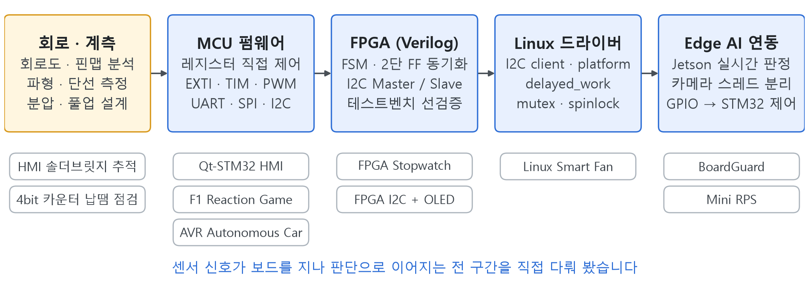

## 👋 About Me

- 🔧 **하드웨어에 가까운 소프트웨어**를 만듭니다. 레지스터를 직접 다루는 MCU 펌웨어부터 FPGA, 리눅스 드라이버, Jetson 위의 판정 로직까지 다뤄 봤습니다.
- 🔍 동작이 설계와 다를 때는 코드만 다시 보지 않고 **회로도·데이터시트·계측값**까지 확인 범위를 넓혀 원인을 찾습니다.
- 🧪 "동작한다"에서 멈추지 않고 **Fail-safe와 검증**(단계별 단독 테스트, 시뮬레이션 선검증)까지 설계하려고 합니다.
- 🎓 전자공학 학사 · **AI 시스템반도체 SW개발자 2기** (대한상공회의소, 2026.05 ~ 2026.12 수료 예정)
- 🎯 **임베디드 HW/FW 신입** 포지션을 준비하고 있습니다.

## 🗺 What I Work On

## 🛠 Tech Stack

| 분야 | 기술 |
|:--|:--|
| **Language** |     |
| **MCU / Board** |     |
| **Firmware** |     |
| **Protocol** |     |
| **Linux / AI** |    |
| **Tools** |      |

## 🚀 Featured Projects

| | 프로젝트 | 핵심 |
|:-:|:--|:--|
| 🚗 | **[Qt-STM32 HMI](https://github.com/Tae86/Qt-STM32_HMI-Project)** 4인 · STM32 펌웨어 | 레지스터 직접 제어 · 인터럽트 전면 적용(DHT11 EXTI 상태머신) · UART 프로토콜 · 500ms 하트비트 Fail-safe |
| 🛡️ | **[BoardGuard](https://github.com/Tae86/pcb-defect-detection-boardguard)** 4인 · AI 파이프라인 | Jetson 실시간 판정 → STM32 GPIO 자동 선별 · 카메라 지연 10초 누적 해결(스레드 분리) · 결함 12종 분류 |
| 🚙 | **[AVR Autonomous Car](https://github.com/Tae86/avr-ultrasonic-autonomous-car)** 개인 제작 | ATmega128 · 초음파 3채널 장애물 회피 FSM · 블루투스 수동/자율 모드 |
| 🏁 | **[F1 Reaction Game](https://github.com/Tae86/stm32-f1-reaction-game)** 개인 | WS2812B RGB(DWT 타이밍) · SysTick 논블로킹 상태머신 · TIM2 32bit 반응시간 측정 |
| ⏱️ | **[FPGA Stopwatch](https://github.com/Tae86/fpga-minsec-stopwatch)** 개인 | Basys3 Verilog 3상태 FSM · 2단 FF 동기화 · 시뮬레이션 선검증 |
| 🔗 | **[FPGA I2C Sensor + OLED](https://github.com/Tae86/fpga-i2c-sensor-oled)** 개인 | Basys3 2장 I2C Master/Slave · byte 엔진 + 시나리오 분리 · SSD1306 OLED 드라이버 · 테스트벤치 4종 |
| 🌀 | **[Linux Smart Fan](https://github.com/Tae86/linux-jetson-smart-fan)** 5인 · 드라이버 2종 | Jetson 커널 드라이버 · BMP180(I2C)·LED BAR(platform) 드라이버 담당 |
| ⚙️ | **[DC Motor Controller](https://github.com/Tae86/stm32-motor-project)** 팀 | L293 H-Bridge + 20kHz PWM · 숏/롱클릭 상태 제어 |
| ✊ | **[Mini RPS](https://github.com/Tae86/jetson-rps-yolo-tensorrt)** 개인 | YOLO → ONNX → TensorRT 온디바이스 가위바위보 |

## 🔎 Troubleshooting Highlights

> 증상 → 원인 → 해결을 기록해 두고 같은 문제를 반복하지 않으려고 합니다.

- **[Qt-STM32 HMI](https://github.com/Tae86/Qt-STM32_HMI-Project)** — 배선·코드가 정상인데 일부 모터만 동작 안 함
  - 원인: PB13~15의 Arduino 헤더가 보드에서 **솔더브릿지로 기본 미연결**
  - 해결: 보드 회로도로 신호 경로를 추적해 Morpho 헤더에 직결
- **[BoardGuard](https://github.com/Tae86/pcb-defect-detection-boardguard)** — 화면 지연이 시간이 지날수록 **최대 10초** 누적
  - 원인: 추론 중 프레임을 읽지 않아 오래된 프레임이 버퍼에 쌓임
  - 해결: 카메라 수신 스레드를 분리해 최신 프레임 1장만 유지
- **[F1 Reaction Game](https://github.com/Tae86/stm32-f1-reaction-game)** — 반응이 1.31초를 넘으면 0ms로 기록
  - 원인: TIM2를 16bit로 설정 (20µs × 65536)
  - 해결: 레퍼런스 매뉴얼로 **32bit 타이머**임을 확인해 확장
- **[FPGA Stopwatch](https://github.com/Tae86/fpga-minsec-stopwatch)** — 보드에서 버튼 방향이 반대로 동작
  - 원인: XDC의 Left/Center 핀 번호가 뒤바뀜
  - 해결: 시뮬레이션으로 로직을 먼저 검증해 두고 보드 자료와 핀을 대조

## 📅 Timeline

| 시기 | 프로젝트 |
|---|---|
| 2026.06 | 🚙 AVR 초음파 자율주행차 (ATmega128) |
| 2026.07 | 🏁 F1 반응속도 게임 (STM32) · ⚙️ DC 모터 컨트롤러 (팀) |
| 2026.08 | 🚗 자동차 HMI 모사 시스템 (STM32 + Qt, 4인) |
| 2026.09 | 🛡️ BoardGuard PCB 불량 탐지·선별 (Jetson + STM32, 4인) |
| 2026.10 | 🌀 Linux 스마트 선풍기 (커널 드라이버, 5인) · ⏱️ FPGA 분/초 시계·스톱워치 |
| 2026.11 | 🔗 FPGA I2C 센서 네트워크 + OLED |

## 📫 Contact

